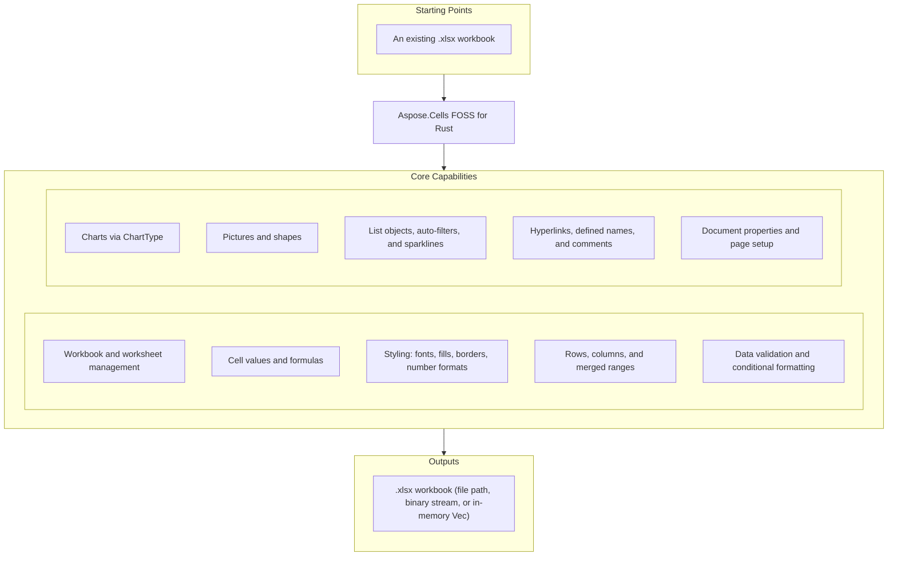

# Aspose.Cells FOSS for Rust

[](LICENSE.txt) [](Cargo.toml)

[](https://products.aspose.org/cells/rust/)

Aspose.Cells FOSS for Rust is a free, open-source, pure-Rust library for creating,
loading, editing, and saving Excel `.xlsx` (Office Open XML / SpreadsheetML) workbooks.
It exposes an API modeled after Aspose.Cells, so
the familiar `Workbook` / `Worksheet` / `Cells` object model is available to Rust
programs with no proprietary runtime, no Microsoft Office installation, and no external
Aspose dependency. The OOXML packaging — ZIP container, relationships, shared strings,
styles, worksheet XML, and charts — is implemented from scratch on top of a small set of
general-purpose crates: `zip` (package container), `roxmltree` (XML parsing), `chrono`
(date/time), `sha2` / `base64` / `getrandom` (protection hashing), and `serde_json`.

## Navigation

- [At a Glance](#at-a-glance)
- [Key Capabilities](#key-capabilities)
- [Installation](#installation)
- [Dependencies](#dependencies)
- [Quick Start](#quick-start)
- [Additional Examples](#additional-examples)
- [Project Structure](#project-structure)
- [API Reference](#api-reference)
- [Documentation & Resources](#documentation--resources)
- [Scope and Limitations](#scope-and-limitations)
- [Development and Testing](#development-and-testing)
- [License](#license)

## At a Glance



## Key Capabilities

- Create a new `Workbook` with `Workbook::new` (starts with one sheet, `"Sheet1"`), or
  load an existing `.xlsx` file from a path (`Workbook::load_xlsx`), a stream
  (`load_xlsx_from_stream`), or in-memory bytes (`load_xlsx_from_bytes`) — with defensive
  repair options via `LoadOptions` (`try_repair_package`, `try_repair_xml`) and structured
  `LoadDiagnostics` for the issues found along the way.
- Manage worksheets through `WorksheetsMut` / `Worksheets` (add, look up by index or
  name, active-sheet state) and `Worksheet` (name, visibility, tab color, gridlines,
  zoom, right-to-left layout, and protection).
- Read and write typed cell values through `Cell` / `CellMut` — `put_value_string`,
  `put_value_i32`, `put_value_bool`, `put_value_decimal`, `put_value_date_time` —
  addressed by A1 name (`get`) or row/column index (`get_by_index`), and enter formulas
  with cached results via `put_formula_with_cached_value`.
- Apply cell styling through `CellStyle` with `Font`, `Fill`, and `Borders`, targeted
  updates via `StyleFlag`, and custom `NumberFormat` strings.
- Size and organize rows, columns, and merged cell areas through `Rows` / `Columns` and `Cells`.
- Enforce data validation rules (`Validation`, `ValidationType`, `OperatorType`) and apply
  conditional formatting — cell-value, expression, color-scale, data-bar, and icon-set
  rules — through `FormatCondition` and `ConditionalFormattingCollection`.
- Build charts through `ChartType` on a worksheet's chart collection — column, line, bar,
  area, pie, doughnut, scatter, radar, bubble, and stock families, plus their stacked and
  3D variants, each rendered as real OOXML chart markup.
- Embed pictures with `Picture` and drawing shapes with `Shape` / `AutoShapeType`
  (rectangles, stars, arrows, and other preset geometries).
- Build structured Excel tables with `ListObject` (table styles, totals), auto-filters
  with `AutoFilter`, and compact in-cell trend charts with `SparklineGroup`.
- Attach hyperlinks (`Hyperlink`), workbook- and sheet-scoped defined names
  (`DefinedName`), and cell comments (`Comment`) with author, note, and visibility
  control.
- Read and write core and extended document properties (`DocumentProperties`,
  `ExtendedDocumentProperties`) and configure print and page layout through `PageSetup`
  (paper size, orientation, margins, page breaks) and `FreezePane`.
- Save back to `.xlsx` — to a file path (`save` / `save_xlsx`), a stream
  (`save_xlsx_to_stream`), or in-memory bytes (`save_xlsx_to_bytes`) — with `SaveOptions`.

## Installation

Add it as a Git dependency in `Cargo.toml`:

```toml
[dependencies]
aspose-cells-foss-rust = { git = "https://github.com/aspose-cells-foss/Aspose.Cells-FOSS-for-Rust" }
```

For local development against a cloned copy, use a path dependency instead:

```toml
[dependencies]
aspose-cells-foss-rust = { path = "../Aspose.Cells-FOSS-for-Rust" }
```

The package name is `aspose-cells-foss-rust`; the library is imported as
`aspose_cells_foss_rust`. Requires a recent stable Rust toolchain (2021 edition or later).
No proprietary Aspose runtime and no Microsoft Office installation is required.

To build the library directly from a clone:

```bash
git clone https://github.com/aspose-cells-foss/Aspose.Cells-FOSS-for-Rust.git
cd Aspose.Cells-FOSS-for-Rust
cargo build
```

## Dependencies

### Required Package Dependencies

- `zip` 0.6 — reads and writes the XLSX ZIP container.
- `roxmltree` 0.20 — parses the OOXML part XML (relationships, shared strings, styles,
  worksheet XML).
- `chrono` 0.4 — date/time handling for cell values and formulas.
- `sha2` 0.10, `base64` 0.22, `getrandom` 0.3 — hashing and encoding used by document
  protection features.
- `serde_json` 1 — JSON support for diagnostics and serialization helpers.

### Native and System Requirements

- Requires a recent stable Rust toolchain (2021 edition or later).

## Quick Start

Create a workbook, write typed values and a formula with a cached result, save it as
XLSX, and load it back:

```rust
use aspose_cells_foss_rust::{CellValue, Workbook};
use std::error::Error;

fn main() -> Result<(), Box<dyn Error>> {
    // Create a new workbook (starts with one sheet, "Sheet1").
    let mut workbook = Workbook::new();
    {
        let mut worksheets = workbook.get_worksheets_mut();
        let sheet = worksheets.get(0)?;
        let mut cells = sheet.get_cells_mut();

        cells.get("A1")?.put_value_string("Hello")?;
        cells.get("B1")?.put_value_i32(123)?;
        cells.get("C1")?.put_value_bool(true)?;
        cells.get("D1")?.put_value_decimal(12.5)?;
        cells.get("F1")?.put_value_i32(10)?;
        cells.get("G1")?
            .put_formula_with_cached_value("=F1*2", CellValue::Number(20.0))?;
    }
    workbook.save("hello.xlsx")?;

    // Load it back.
    let loaded = Workbook::load_xlsx("hello.xlsx")?;
    let sheet = loaded.worksheet("Sheet1")?;
    let cells = sheet.get_cells();
    println!("A1 = {}", cells.get("A1")?.display_string_value());

    Ok(())
}
```

## Additional Examples

More real, runnable examples are collected below — see [`samples/`](samples/) and
[`samples/README.md`](samples/README.md) for the complete set.

### Load XLSX Files With Repair Options

Open workbooks defensively with `LoadOptions` repair flags and inspect structured load
diagnostics:

```rust
let options = LoadOptions {
    try_repair_package: true,
    try_repair_xml: true,
    ..LoadOptions::default()
};

let loaded = Workbook::load_xlsx_with_options(&valid_path, &options)?;
let sheet = loaded.worksheet("Sheet1")?;
let cells = sheet.get_cells();

println!(
    "Loaded workbook with {} worksheet(s) and {} diagnostic issue(s).",
    loaded.get_worksheets().count(),
    loaded.get_load_diagnostics().issues().len()
);
```

<details>
<summary>View Additional Examples</summary>

### Add Charts From Data Ranges

```rust
let mut charts = sheet.get_charts();
charts.add(
    ChartType::Column,
    "Charts!$B$1:$B$13".to_string(),
    0, 4, 18, 8,
)?;
charts.add(
    ChartType::Line,
    "Charts!$C$1:$C$13".to_string(),
    0, 9, 18, 13,
)?;

let chart_count = charts.count();
let first = charts.get(0).expect("chart");
println!("Chart count: {}", chart_count);
println!("First chart type: {:?}", first.get_chart_type());
```

### Apply Conditional Formatting Rules

```rust
let mut collections = sheet.get_conditional_formattings();

let between_index = collections.add();
let mut between = collections.get(between_index).expect("collection should exist");
between.add_area(CellArea::create_cell_area_a1("A1", "A10")?)?;
let rule_index = between.add_condition_with_details(
    FormatConditionType::CellValue,
    OperatorType::Between,
    "3",
    "7",
);
let mut rule = between.get(rule_index).expect("rule should exist");
rule.set_priority(1)?;
let mut style = rule.get_style();
style.pattern = FillPattern::Solid;
style.fill_color = Some("FFFFC7CE".to_string());
rule.set_style(style);
```

### Enforce Data Validation Rules

```rust
let mut validations = sheet.get_validations();
let list_index = validations.add(CellArea::create_cell_area_a1("A1", "A3")?)?;
let mut list_validation = validations.get(list_index).expect("validation should exist");
list_validation.set_type(ValidationType::List);
list_validation.set_formula1("\"Open,Closed\"");
list_validation.set_in_cell_drop_down(true);
list_validation.set_show_error(true);
list_validation.set_error_title("Invalid");
list_validation.set_error_message("Choose from the list");
```

### Build a Structured Excel Table (ListObject)

```rust
let mut tables = sheet.get_list_objects();
let table_index = tables.add_a1("A1", "D5", true)?;
let mut table = tables.get(table_index as usize).expect("table should exist");
table.set_display_name("Products")?;
table.set_table_style_type(TableStyleType::TableStyleMedium2);
table.set_show_totals(true);

let mut columns = table.get_list_columns();
columns.get(3).expect("quantity column").set_totals_calculation(TotalsCalculation::Sum);
```

### Hyperlinks and Defined Names

```rust
let mut hyperlinks = links_sheet.get_hyperlinks();
let external_index = hyperlinks.add("A1", 1, 1, "https://example.com/docs?q=1")?;
let mut external_link = hyperlinks.get(external_index).expect("hyperlink should exist");
external_link.set_text_to_display("Docs");
external_link.set_screen_tip("External docs");

let mut defined_names = workbook.get_defined_names();
let global_index = defined_names.add("GlobalRange", "='Links'!$A$1:$D$5")?;
defined_names.get(global_index).expect("defined name should exist").set_hidden(true);
```

</details>

## Project Structure

The library source lives under `src/Aspose.Cells_FOSS/`, one module per public type, with
runnable samples alongside it at the repository root:

```
├── src/
│   ├── lib.rs                      # Crate root; re-exports the public API
│   └── Aspose.Cells_FOSS/
│       ├── api.rs                  # Wires the modules together
│       ├── Core/                   # Internal data models
│       ├── Packaging/              # OOXML package (ZIP) reading/writing
│       ├── Xml/                    # SpreadsheetML XML mappers
│       ├── Validation/             # Workbook validation
│       ├── ChartDefaults/          # Default chart XML templates
│       ├── Workbook.rs             #   Workbook entry point
│       ├── Worksheet.rs            #   Worksheet model
│       ├── Cell.rs / Cells.rs      #   Cell model and collection
│       ├── Style.rs                #   Styles (font, fill, alignment, border)
│       ├── Validation.rs           #   Data validation
│       ├── Chart.rs / ChartLive.rs #   Charts
│       └── ...                     # One module per public type (Comment, Hyperlink, ListObject, ...)
├── samples/                        # Runnable feature examples
│   ├── basic.rs
│   ├── styles.rs
│   ├── charts.rs
│   ├── ...                         # One sample per feature area
│   └── README.md                   # Sample overview
├── License/LICENSE.txt             # MIT license (also mirrored at the repository root)
├── AGENTS.md                       # AI-assisted development guide
├── Cargo.toml
└── README.md
```

## API Reference

The primary entry point is `Workbook`, which owns a `Worksheets` / `WorksheetsMut`
collection of `Worksheet` objects. Each `Worksheet` exposes its cells through
`get_cells()` / `get_cells_mut()`, returning a `Cells` / `CellsMut` accessor used for
individual `Cell` / `CellMut` access, row/column collections, and merged ranges. The
public API surface includes 213 public types, summarized in the module-grouped table
below.

<details>
<summary>View the Complete Public API Surface</summary>

### Core API

#### Structs

| Struct | Description |
|---|---|
| `AlignmentValue` | Struct with 1 method. |
| `AutoFilter` | Represents auto filter. |
| `AutoFilterColorFilter` | Represents auto filter color filter. |
| `AutoFilterColorFilterModel` | Struct with 1 method. |
| `AutoFilterCustomFilter` | Represents auto filter custom filter. |
| `AutoFilterCustomFilterCollection` | Represents a collection of auto filter custom filter objects. |
| `AutoFilterCustomFilterModel` | Struct extending Default. |
| `AutoFilterDynamicFilter` | Represents auto filter dynamic filter. |
| `AutoFilterDynamicFilterModel` | Struct with 1 method. |
| `AutoFilterModel` | Struct with 2 methods. |
| `AutoFilterSortCondition` | Represents auto filter sort condition. |
| `AutoFilterSortConditionCollection` | Represents a collection of auto filter sort condition objects. |
| `AutoFilterSortConditionModel` | Struct extending Default. |
| `AutoFilterSortState` | Represents auto filter sort state. |
| `AutoFilterSortStateModel` | Struct with 2 methods. |
| `AutoFilterTop10` | Represents auto filter top10. |
| `AutoFilterTop10Model` | Struct with 1 method. |
| `Border` | Represents border. |
| `BorderSideValue` | Struct with 1 method. |
| `Borders` | Represents borders. |
| `BordersValue` | Struct with 1 method. |
| `CalculationProperties` | Represents calculation properties. |
| `CalculationPropertiesModel` | Struct with 2 methods. |
| `Cell` | Represents a single worksheet cell and exposes value, formula, and style operations. |
| `CellArea` | Represents cell area. |
| `CellFormatValue` | Struct extending Default. |
| `CellMut` | Represents a single worksheet cell and exposes value, formula, and style operations. |
| `CellRange` | Struct with 2 properties. |
| `CellRecord` | Struct extending Default. |
| `CellRef` | Struct with 2 properties. |
| `CellStyle` | Represents a mutable cell style facade that can be applied to one or more cells. |
| `Cells` | Provides access to worksheet cells, rows, columns, and merged ranges. |
| `CellsException` | Represents an error that occurs during cells. |
| `CellsMut` | Provides access to worksheet cells, rows, columns, and merged ranges. |
| `Chart` | Represents a chart embedded in a worksheet. |
| `ChartCollection` | Represents collection of charts on a worksheet. |
| `ChartCompanionFile` | Struct extending Default. |
| `ChartModel` | Struct extending Default. |
| `ChartXmlTemplates` | Struct with 24 methods. |
| `Color` | Represents color. |
| `ColorValue` | Struct with 2 methods and 4 properties. |
| `Column` | Represents column. |
| `ColumnMut` | Represents column. |
| `ColumnProperties` | Encapsulates a single worksheet and its supported v0.1 worksheet features. |
| `ColumnRangeModel` | Struct extending Default. |
| `Columns` | Represents a collection of column objects. |
| `ColumnsMut` | Represents a collection of column objects. |
| `Comment` | Represents a worksheet comment (legacy note) anchored to a single cell. |
| `CommentCollection` | Represents the collection of comments (legacy notes) on a worksheet. |
| `CommentModel` | Struct extending Default. |
| `ConditionalFormattingCollection` | Represents a collection of conditional formatting objects. |
| `ConditionalFormattingModel` | Struct extending Debug. |
| `CoreDocumentProperties` | Represents core document properties. |
| `CoreDocumentPropertiesModel` | Struct with 2 methods. |
| `DefinedName` | Represents defined name. |
| `DefinedNameCollection` | Represents a collection of defined name objects. |
| `DefinedNameModel` | Struct extending Default. |
| `DefinedNameUtility` | Struct with 5 methods. |
| `DiagnosticBag` | Struct with 1 method and 1 property. |
| `DiagnosticEntry` | Struct extending Default. |
| `DisplayFormatSectionInfo` | Struct extending Default. |
| `DisplayTextDateFormatSupport` | Struct with 17 methods. |
| `DisplayTextFormatter` | Struct with 2 methods. |
| `DisplayTextFormatterSupport` | Struct with 16 methods. |
| `DisplayTextLocaleSupport` | Struct with 4 methods. |
| `DocumentProperties` | Represents document properties. |
| `DocumentPropertiesModel` | Struct with 2 methods. |
| `ExtendedDocumentProperties` | Represents extended document properties. |
| `ExtendedDocumentPropertiesModel` | Struct with 2 methods. |
| `ExternalLinkModel` | Struct extending Default. |
| `Fill` | Represents a mutable cell style facade that can be applied to one or more cells. |
| `FillValue` | Struct extending Default. |
| `FilterColumn` | Represents filter column. |
| `FilterColumnCollection` | Represents a collection of filter column objects. |
| `FilterColumnModel` | Struct with 2 methods. |
| `FilterValueCollection` | Represents a collection of filter value objects. |
| `Font` | Represents font. |
| `FontValue` | Struct with 1 method. |
| `FormatCondition` | Represents format condition. |
| `FormatConditionCollection` | Represents a collection of format condition objects. |
| `FormatConditionModel` | Struct with 1 method. |
| `FormulaException` | Represents an error that occurs during formula. |
| `FreezePane` | Encapsulates a single worksheet and its supported v0.1 worksheet features. |
| `Hyperlink` | Represents hyperlink. |
| `HyperlinkCollection` | Encapsulates the hyperlinks defined for a worksheet. |
| `HyperlinkModel` | Struct extending Default. |
| `IListObjectOwner` | Struct extending Default. |
| `IPackageReader` | Struct extending Default. |
| `IPackageWriter` | Struct extending Default. |
| `InvalidFileFormatException` | Represents an error that occurs during invalid file format. |
| `ListColumn` | Represents a single column in an Excel table. |
| `ListColumnCollection` | Represents the ordered collection of columns in an Excel table. |
| `ListColumnModel` | Struct extending Default. |
| `ListObject` | Represents an Excel table (structured reference / ListObject). |
| `ListObjectCollection` | Represents the collection of Excel tables on a worksheet. |
| `ListObjectModel` | Struct extending Default. |
| `ListObjectSupport` | Struct with 12 methods. |
| `LoadDiagnostics` | Represents load diagnostics. |
| `LoadIssue` | Represents load issue. |
| `LoadOptions` | Specifies how a workbook should be loaded. |
| `MergeRegion` | Struct extending Default. |
| `MissingPartException` | Struct extending Default. |
| `NumberFormat` | Provides number format operations. |
| `NumberFormatValue` | Struct with 1 method. |
| `PackageLoadContext` | Struct extending Default. |
| `PackageModel` | Struct extending Default. |
| `PackagePartDescriptor` | Struct extending Default. |
| `PackageStructureException` | Struct extending Default. |
| `PackagingConventions` | Struct extending Default. |
| `PageSetup` | Represents worksheet print and page-layout settings. |
| `Picture` | Represents a picture (image) anchored to a worksheet. |
| `PictureCollection` | Represents collection of pictures anchored to a worksheet. |
| `PictureModel` | Struct extending Default. |
| `ProtectionValue` | Struct with 1 method. |
| `RelationshipDescriptor` | Struct extending Default. |
| `RelationshipResolutionException` | RelationshipResolutionException is thrown when the library cannot resolve a package relationship during load or save. |
| `Row` | Represents row. |
| `RowModel` | Struct extending Default. |
| `RowMut` | Represents row. |
| `RowProperties` | Encapsulates a single worksheet and its supported v0.1 worksheet features. |
| `Rows` | Represents a collection of row objects. |
| `RowsMut` | Represents a collection of row objects. |
| `SaveOptions` | Specifies how a workbook should be saved. |
| `Shape` | Represents a drawing object (auto shape) anchored to a worksheet. |
| `ShapeCollection` | Represents collection of drawing objects (shapes) on a worksheet. |
| `ShapeImageModel` | Struct extending Default. |
| `ShapeModel` | Struct extending Default. |
| `SharedStringRepository` | Struct with 3 methods and 2 properties. |
| `SharedStringTableXmlMapper` | Struct with 2 methods. |
| `SparklineGroup` | A sparkline group contains sparkline items that share type and settings. |
| `SparklineGroupCollection` | Represents a collection of sparkline groups on a worksheet. |
| `StyleException` | Represents an error that occurs during style. |
| `StyleFlag` | Represents flags which indicate applied formatting properties. |
| `StyleRepository` | Struct with 1 method. |
| `StyleValue` | Struct with 1 method. |
| `StyleValueSanitizer` | Struct with 3 methods. |
| `StylesheetLoadContext` | Struct extending Default. |
| `StylesheetSaveContext` | Struct with 2 methods and 2 properties. |
| `StylesheetXmlMapper` | Struct with 2 methods. |
| `UnsupportedFeatureException` | Represents an error that occurs during unsupported feature. |
| `Validation` | Represents validation. |
| `ValidationCollection` | Represents a collection of validation objects. |
| `ValidationMessage` | Struct extending Default. |
| `ValidationModel` | Struct with 1 method and 14 properties. |
| `WarningInfo` | Represents warning info. |
| `Workbook` | Represents the root spreadsheet object used to create, load, modify, and save an XLSX workbook. |
| `WorkbookLoadException` | Represents an error that occurs during workbook load. |
| `WorkbookModel` | Struct extending Default. |
| `WorkbookProperties` | Represents workbook properties. |
| `WorkbookPropertiesModel` | Struct with 2 methods. |
| `WorkbookProtection` | Represents workbook protection. |
| `WorkbookProtectionModel` | Struct with 2 methods. |
| `WorkbookSaveException` | Represents an error that occurs during workbook save. |
| `WorkbookSettings` | Represents workbook-level settings that affect date handling and display formatting. |
| `WorkbookSettingsModel` | Struct extending Default. |
| `WorkbookValidator` | Struct with 1 method. |
| `WorkbookView` | Represents workbook view. |
| `WorkbookViewModel` | Struct with 2 methods. |
| `WorkbookXmlMapper` | Struct with 2 methods. |
| `Worksheet` | Encapsulates a single worksheet and its supported v0.1 worksheet features. |
| `WorksheetDefinedNamesState` | Struct extending Default. |
| `WorksheetModel` | Struct extending Default. |
| `WorksheetProtection` | Represents worksheet protection. |
| `WorksheetProtectionModel` | Struct with 2 methods. |
| `WorksheetViewModel` | Struct extending Default. |
| `WorksheetXmlMapper` | Struct with 2 methods. |
| `Worksheets` | Encapsulates the workbook's worksheets and active-sheet state. |
| `WorksheetsMut` | Encapsulates the workbook's worksheets and active-sheet state. |
| `XlsxWorkbookCommentsLoader` | Struct with 10 methods. |
| `XlsxWorkbookDefinedNames` | Struct with 9 methods. |
| `XlsxWorkbookPicturesLoader` | Struct with 40 methods. |
| `XlsxWorkbookProperties` | Struct with 13 methods. |
| `XlsxWorkbookStylesValueHelpers` | Struct with 9 methods. |
| `XlsxWorkbookStylesXml` | Struct with 31 methods. |
| `XlsxWorkbookWorksheetProtection` | Struct with 6 methods. |
| `XlsxWorkbookWorksheetViews` | Struct with 12 methods. |
| `XmlParsingException` | Struct extending Default. |

#### Enumerations

| Enumeration | Description |
|---|---|
| `AutoShapeType` | Specifies the type of an auto shape (preset geometry). |
| `BorderLineStyle` | Represents border. |
| `BorderStyle` | Enum with 14 members. |
| `BorderStyleType` | Specifies border style type. |
| `CellObjectValue` | Enum with 14 methods and 5 members. |
| `CellValue` | Enum with 8 methods and 7 members. |
| `CellValueKind` | Enum with 7 members. |
| `CellValueType` | Specifies cell value type. |
| `CellsError` | Enum with 9 methods and 10 members. |
| `ChartType` | Specifies the chart type. |
| `DateSystem` | Enum with 2 members. |
| `DiagnosticSeverity` | Enum with 4 members. |
| `FillPattern` | Specifies fill pattern. |
| `FillPatternKind` | Enum with 18 members. |
| `FilterOperatorType` | Represents FilterOperatorType. |
| `FontUnderlineType` | Enumerates font underline types. |
| `FormatConditionType` | Specifies format condition type. |
| `HorizontalAlignment` | Enum with 8 members. |
| `ImageType` | Represents the format of an image stored in a worksheet. |
| `LoadFormat` | Specifies load format. |
| `OperatorType` | Specifies operator type. |
| `PageOrientation` | Enum with 1 method and 3 members. |
| `PageOrientationType` | Specifies page orientation type. |
| `PaperSizeType` | Specifies paper size type. |
| `SaveFormat` | Specifies save format. |
| `SheetVisibility` | SheetVisibility enum defines three visibility states: Visible, Hidden, and VeryHidden. |
| `SparklineType` | Represents SparklineType. |
| `TableStyleType` | Represents the built-in Excel table style types. |
| `TargetModeType` | Specifies target mode type. |
| `TotalsCalculation` | Represents the aggregation function shown in a table totals row cell. |
| `ValidationAlertType` | Specifies validation alert type. |
| `ValidationMessageSeverity` | Enum with 3 members. |
| `ValidationType` | Specifies validation type. |
| `VerticalAlignment` | Enum with 5 members. |
| `VisibilityType` | Specifies visibility type. |

#### Traits

| Class | Description |
|---|---|
| `IWarningCallback` | Defines a callback that receives load warnings. |

---

#### Detailed Member Reference

### Workbook and Worksheets

- `Workbook`
  - `new() -> Workbook` / `load_xlsx(path)` / `load_xlsx_from_stream(reader)` / `load_xlsx_from_bytes(bytes)`
  - `load_xlsx_with_options(path, &LoadOptions)`
  - `get_worksheets() -> Worksheets` / `get_worksheets_mut() -> WorksheetsMut`
  - `worksheet(name) -> Result<Worksheet, CellsError>`
  - `get_settings() -> WorkbookSettings`, `get_properties() -> WorkbookProperties`
  - `get_document_properties() -> DocumentProperties`
  - `get_defined_names() -> DefinedNameCollection`
  - `get_load_diagnostics() -> LoadDiagnostics`
  - `save(path)` / `save_xlsx(path)` / `save_with_format(path, format)`
  - `save_xlsx_to_stream(writer)` / `save_xlsx_to_bytes() -> Vec<u8>`
- `WorksheetsMut` / `Worksheets`
  - `count() -> usize`, `add(name) -> usize`
  - `get(index)` / `get_by_name(name)`
  - `remove_at(index)` — returns `CellsError::Unsupported` if it is the sole remaining worksheet
- `Worksheet`
  - `get_name()` / `set_name(value)`, `get_visibility_type()` / `set_visibility_type(value)`
  - `get_tab_color()` / `set_tab_color(value)`
  - `get_show_gridlines()`, `get_show_row_column_headers()`, `get_right_to_left()`
  - `get_cells() -> Cells` / `get_cells_mut() -> CellsMut`
  - `get_hyperlinks()`, `get_validations()`, `get_conditional_formattings()`, `get_auto_filter()`
  - `get_page_setup_mut() -> PageSetup`, `get_charts() -> ChartCollection`
  - `get_pictures()`, `get_shapes()`, `get_list_objects()`, `get_sparkline_groups()`

### Cells, Values, and Formulas

- `Cells` / `CellsMut`
  - `get(a1_address) -> Result<Cell, CellsError>` / `get_by_index(row, column)`
  - `get_rows() -> Rows`, `get_columns() -> Columns`
- `Cell` / `CellMut`
  - `put_value_string(value)`, `put_value_i32(value)`, `put_value_f64(value)`,
    `put_value_bool(value)`, `put_value_decimal(value)`, `put_value_date_time(value)`
  - `put_formula_with_cached_value(formula, CellValue)`
  - `display_string_value() -> String`, `value_type() -> CellValueType`
  - `get_style() -> CellStyle` / `set_style(style)`

### Styling

- `CellStyle`
  - `get_font_mut() -> &mut Font`, `pattern: FillPattern`, `fill_color: Option<String>`
- `Font`
  - `set_color(value)`, `set_is_bold(value)`, `set_is_italic(value)`, `set_underline(value)`
- `Color`
  - `from_argb(a, r, g, b) -> Color`
- `PageSetup`
  - `set_left_margin_inch(value)`, `set_right_margin_inch(value)`

### Load and Save Options

- `LoadOptions`
  - `try_repair_package: bool`, `try_repair_xml: bool` (`..LoadOptions::default()`)
- `SaveOptions` — passed to `save_with_options` / `save_xlsx_to_stream_with_options`

### Validation and Conditional Formatting

- `Validation` — `set_type(ValidationType)`, `set_formula1(value)`, `set_formula2(value)`,
  `set_operator(OperatorType)`, `set_show_error(value)`, `set_error_title(value)`
- `FormatCondition` — `set_priority(value)`, `set_stop_if_true(value)`, `get_style()` / `set_style(style)`
- `ConditionalFormattingCollection` — `add()`, `add_condition_with_details(FormatConditionType, OperatorType, formula1, formula2)`

### Exceptions

- `CellsError` (enum, 10 members including `Unsupported(&'static str)`, `Io(String)`)
- `WorkbookLoadException`, `WorkbookSaveException`, `CellsException`, `FormulaException`,
  `StyleException`, `InvalidFileFormatException`, `UnsupportedFeatureException`

</details>

## Documentation & Resources

- **[Getting started guide](https://docs.aspose.org/cells/rust/)** — installation, walkthroughs, and feature guides for this library.
- **[How-to guides & FAQ](https://kb.aspose.org/cells/rust/)** — task-focused answers for common spreadsheet-processing questions.
- **[Full API reference](https://reference.aspose.org/cells/rust/)** — the complete, browsable reference for the public API surface (the [API reference](#api-reference) section above covers the essentials).
- **[Samples overview](samples/README.md)** — every runnable example, one per feature area.
- **[Contributor guide](AGENTS.md)** — architecture notes, module wiring, and conventions for contributors.
- Found a bug or have a feature request? [Open an issue](https://github.com/aspose-cells-foss/Aspose.Cells-FOSS-for-Rust/issues) on GitHub.

## Scope and Limitations

- Reads and writes `.xlsx` (OOXML/SpreadsheetML) only — no legacy `.xls` (BIFF), ODS, or CSV.
- A workbook must always keep at least one worksheet: `WorksheetsMut::remove_at` returns
  a `CellsError::Unsupported` error when asked to remove the last remaining worksheet.
- The public API surface is broad but, by the repository's own account, not a complete
  match for Aspose.Cells — some features are still partial, and the crate is early-stage
  and evolving.
- No automated test suite ships yet (`cargo test --all-targets` currently reports 0
  tests) — see [Development and Testing](#development-and-testing) for how correctness is
  exercised today.

These limitations don't apply to
[Aspose.Cells — Enterprise Edition](https://products.aspose.com/cells/), which adds
broader format coverage (including legacy XLS, CSV, and ODS), full feature completeness,
and commercial support.

## Development and Testing

The repository currently has no unit or integration test suite —
`cargo test --all-targets` reports 0 tests. The `samples/` directory is the de-facto
verification suite instead: each sample creates a workbook, saves it under
`output/samples/`, loads it back, and prints what it read. After a change that touches
the read/write path, run the core samples and confirm they still round-trip:

```bash
cargo build
cargo check --all-targets
cargo fmt --all --check
cargo clippy --all-targets
cargo test --all-targets
cargo run --bin sample_basic
cargo run --bin sample_loading
cargo run --bin sample_styles
```

CI ([`ci.yml`](.github/workflows/ci.yml)) runs `fmt`, `check`, `clippy`, `test`, the three
samples above as smoke tests, and `cargo bench` on Linux x64, Windows x64, macOS ARM, and
macOS x64. The `samples/` directory demonstrates every feature area — `basic.rs`,
`styles.rs`, `worksheet_settings.rs`, `validations.rs`, `conditional_formatting.rs`,
`hyperlinks_and_names.rs`, `pagesetup.rs`, `comments.rs`, `charts.rs`, `list_objects.rs`,
`pictures.rs`, `shapes.rs`, and `document_properties.rs` (see
[`samples/README.md`](samples/README.md) for the full overview). Generate local API docs
with `cargo doc --no-deps --open`; published API docs are deployed by GitHub Pages
through [`pages.yml`](.github/workflows/pages.yml) — enabling
`Settings -> Pages -> GitHub Actions` on the repository makes pushes to `main`
automatically rebuild and publish the rustdoc site.

## License

This project is licensed under the [MIT License](LICENSE.txt). The MIT License permits
use, copying, modification, distribution, sublicensing, and commercial use, provided its
copyright and permission notice are retained. The software is provided without warranty.
