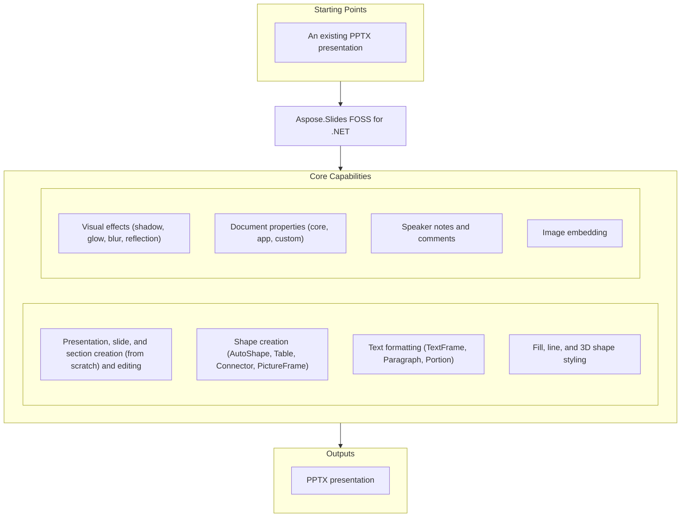

# Aspose.Slides FOSS for .NET

[](https://github.com/aspose-slides-foss/Aspose.Slides-FOSS-for-.NET/actions/workflows/ci.yml) [](LICENSE) [](src/Aspose.Slides.Foss/Aspose.Slides.Foss.csproj)

[](https://products.aspose.org/slides/net/)

Aspose.Slides FOSS for .NET is a free, open-source, MIT-licensed .NET library for creating,
reading, and editing PowerPoint `.pptx` presentations by building the Office Open XML package
itself. It targets `net9.0`, ships with no third-party package dependencies at all, no native
dependency, and needs no PowerPoint installation or COM interop — it implements its own minimal
OPC packaging layer (parts, relationships, content types) internally, on top of the .NET base
class library's own ZIP and XML support — and exposes a broad set of presentation-editing
features covering slides, shapes, text, styling, and document metadata. It is for developers who
need to generate or modify decks on a server or in a build, working inside the PowerPoint file
format itself; it is not a renderer or a converter — it does not produce PDF, HTML, or images
(see [Scope and Limitations](#scope-and-limitations) for the full boundary).

## Navigation

- [At a Glance](#at-a-glance)
- [Key Capabilities](#key-capabilities)
- [Installation](#installation)
- [Dependencies](#dependencies)
- [Quick Start](#quick-start)
- [Additional Examples](#additional-examples)
- [API Reference](#api-reference)
- [Documentation & Resources](#documentation--resources)
- [Scope and Limitations](#scope-and-limitations)
- [Development and Testing](#development-and-testing)
- [License](#license)

## At a Glance



## Key Capabilities

The diagram above is an overview, not a contract. Each box is expanded here, with the XML it
produces; the boundaries are under [Scope and Limitations](#scope-and-limitations). Everything
below was exercised through the public API and then confirmed by reading the XML inside the file
that came out.

- Open an existing `.pptx` file or create a new `Presentation` from scratch, then save it back to
  `.pptx` — unknown XML parts encountered on load are preserved verbatim, so round-tripping a file
  never strips content this library doesn't yet recognize.
- Manage slides through `SlideCollection` — add empty, insert, remove (the slide part is removed
  from the package, not just from the list), clone, hide (`<p:sld show="0">`), and iterate;
  masters and layouts are enumerable and a master can be cloned — or organize slides into
  `Section` groups via `SectionCollection`, with add, append, remove, remove-with-slides, and
  reorder-with-slides.
- Add shapes — AutoShapes for 187 of the 189 `ShapeType` values (each was independently written
  into its own file and confirmed to produce its own distinct `<a:prstGeom prst="…">`; the two
  exceptions, `NotDefined` and `Custom`, have no preset to write and come out as `prst="rect"`),
  plus PictureFrames, Tables, and Connectors bound to shapes by connection site — through
  `ShapeCollection.AddAutoShape()`, `AddPictureFrame()`, `AddTable()`, and `AddConnector()`, with
  `Reorder` for z-order and adjust values on geometry shapes; shapes already grouped in a loaded
  file are recognized as `GroupShape`, though groups cannot be created or modified programmatically.
- Style text through `TextFrame`, `Paragraph`, and `Portion` — text frames, paragraphs, and
  portions all expose character formatting (bold, italic, underline, strikethrough, size, spacing,
  caps, and latin/east-Asian/complex-script/symbol fonts) via `PortionFormat`; paragraph formatting
  (alignment, indent, margins, spacing, and symbol or numbered bullets) via
  `Paragraph.ParagraphFormat`; and text-frame formatting (margins, wrap, anchor, autofit, columns,
  rotation, and vertical text) via `TextFrame.TextFrameFormat`.
- Style shapes with `FillFormat` — solid, gradient (stops, direction, shape, angle, tile flip),
  pattern, and picture fills (crop, stretch, tile, and fill mode), no-fill, applying uniformly to
  shapes, lines, text portions, and table cells — and `LineFormat` for line width, dash style and
  custom dash pattern, cap, join, miter limit, compound style, alignment, and arrowheads at both
  ends with style, width, and length.
- Apply visual effects through `EffectFormat` — all eight are independently verified to produce
  their own element inside `<a:effectLst>`: outer shadow (`a:outerShdw`), inner shadow
  (`a:innerShdw`), glow (`a:glow`), soft edge (`a:softEdge`), reflection (`a:reflection`), blur
  (`a:blur`), preset shadow (`a:prstShdw`), and fill overlay (`a:fillOverlay`).
- Configure 3D bevel top and bottom, extrusion height and colour, contour width and colour,
  material preset, a camera with a preset/field of view/zoom/rotation, and a light rig with a
  preset/direction/rotation, through `ThreeDFormat`.
- Build tables with rows, columns, cells, cell merge (splitting optional), cell fill, all six
  cell borders, cell margins and anchoring, and a table style preset written as
  `<a:tableStyleId>`.
- Read and write core, app, and custom document properties through `DocumentProperties`
  (`docProps/core.xml`, `docProps/app.xml`, and `docProps/custom.xml` are all written), including
  `SetCustomPropertyValue()`.
- Attach per-slide speaker notes (written with the notes master it requires, plus footer text,
  footer visibility, and slide-number visibility) via `NotesSlideManager.AddNotesSlide()`, and
  classic-list comments with authors, timestamps, and positions via
  `CommentAuthorCollection.AddAuthor()` and `CommentCollection.AddComment()` — not the modern
  threaded-comment part; see [Scope and Limitations](#scope-and-limitations).
- Embed images from a byte array or a stream (deduplicated by content) through
  `Presentation.Images.AddImage()`, and reference them from `PictureFrame` shapes — there is no
  overload that takes a file path.

## Installation

Install it from a source checkout (requires the [.NET 9.0 SDK](https://dotnet.microsoft.com/download)):

```bash
git clone https://github.com/aspose-slides-foss/Aspose.Slides-FOSS-for-.NET.git
cd Aspose.Slides-FOSS-for-.NET
dotnet build
```

Reference the library project directly from your own `.csproj`:

```xml
<ItemGroup>
  <ProjectReference Include="path/to/Aspose.Slides-FOSS-for-.NET/src/Aspose.Slides.Foss/Aspose.Slides.Foss.csproj" />
</ItemGroup>
```

The library targets `net9.0` and has no third-party package dependencies.

Every push whose tests pass also produces a `.nupkg` and a symbol `.snupkg` as workflow artefacts,
downloadable from the repository's [Actions](https://github.com/aspose-slides-foss/Aspose.Slides-FOSS-for-.NET/actions)
tab as an alternative to building from source — extract the downloaded `.zip`, point a local
`nuget.config` package source at the extracted folder, then reference the package from that local
source. The package version tracks `Version` in `Directory.Build.props`; use whatever version the
artefact you downloaded is called.

## Dependencies

### Required Package Dependencies

No required third-party package dependencies.

### Native and System Requirements

- Targets `net9.0` (`TargetFramework` in `Aspose.Slides.Foss.csproj`).
- No native dependencies — no `DllImport`, no `LibraryImport`, no `unsafe` code. The CI workflow
  builds and runs every test on `ubuntu-latest`, `windows-latest`, and `macos-latest`. A `net9.0`
  assembly also loads on later .NET runtimes by roll-forward, but CI does not exercise that.

### Development Dependencies

- `xunit` and `xunit.runner.visualstudio` — the test framework and runner used by this project's
  own test suite.
- `Microsoft.NET.Test.Sdk` — the .NET test SDK required to build and run the test projects.
- `FluentAssertions` — the assertion library used in this project's own tests.
- `coverlet.collector` — the code-coverage collector used by this project's own test tooling.

## Quick Start

```csharp
using Aspose.Slides.Foss;
using Aspose.Slides.Foss.Export;

// Open an existing presentation
using var prs = new Presentation("input.pptx");
Console.WriteLine($"Slides: {prs.Slides.Count}");
prs.Save("output.pptx", SaveFormat.Pptx);

// Create a new presentation
using var newPrs = new Presentation();
var slide = newPrs.Slides[0];
newPrs.Save("new.pptx", SaveFormat.Pptx);
```

A new `Presentation` is a 13-part package with one slide, one master, one layout, and a slide
size of `9144000 × 6858000` EMU — 4:3, `type="screen4x3"`; there is no API to change the slide
size. `IBaseSlide.Shapes` is declared `IShapeCollection?` and returns `null` for a slide not
backed by a package part — a few other members are annotated the same way, which is why some
samples on this page use the null-forgiving `!` operator.

## Additional Examples

One runnable snippet per feature area. Every example below was compiled and executed against
this revision, and the values quoted after each one were read out of the `.pptx` it wrote by an
independent ZIP/XML reader — not by asking the library to read its own file back. `Color` and
`PointF` used in these samples are this library's own types in `Aspose.Slides.Foss.Drawing`, not
the `System.Drawing` types of the same name.

Three namespaces cover every sample on this page, and each sample below assumes all three:
`Aspose.Slides.Foss`, `Aspose.Slides.Foss.Drawing`, and `Aspose.Slides.Foss.Export` — those are
this library's own namespaces. The samples also use `Console`, `DateTime`, `File`, `FileStream`,
and `MemoryStream`, which come from `System` and `System.IO`: `<ImplicitUsings>` brings both into
scope by default in a project from `dotnet new console` — the same default this page relies on for
`Nullable` above. Turn implicit usings off and you add those two `using` lines yourself.

### Shapes

```csharp
using Aspose.Slides.Foss;
using Aspose.Slides.Foss.Export;

using var prs = new Presentation();
var slide = prs.Slides[0];
var shape = slide.Shapes.AddAutoShape(ShapeType.Rectangle, 50, 50, 300, 100);
shape.AddTextFrame("Hello, world!");
prs.Save("shapes.pptx", SaveFormat.Pptx);
```

<details>
<summary>View Additional Examples</summary>

### Text Formatting

```csharp
using Aspose.Slides.Foss;
using Aspose.Slides.Foss.Drawing;
using Aspose.Slides.Foss.Export;

using var prs = new Presentation();
var shape = prs.Slides[0].Shapes.AddAutoShape(ShapeType.Rectangle, 50, 50, 400, 150);
var tf = shape.AddTextFrame("Formatted text");
var fmt = tf.Paragraphs[0].Portions[0].PortionFormat;
fmt.FontHeight = 24;
fmt.FontBold = NullableBool.True;
fmt.FillFormat.FillType = FillType.Solid;
fmt.FillFormat.SolidFillColor.Color = Color.FromArgb(255, 0, 70, 127);
prs.Save("text.pptx", SaveFormat.Pptx);
```

In `ppt/slides/slide1.xml`: `<a:rPr b="1" sz="2400">`, `<a:latin typeface="Verdana"/>`,
`<a:pPr algn="ctr">`.

### Table

```csharp
using Aspose.Slides.Foss;
using Aspose.Slides.Foss.Export;

using var prs = new Presentation();
var table = prs.Slides[0].Shapes.AddTable(50, 50, [150.0, 150.0], [40.0, 40.0]);
table.Rows[0][0].TextFrame.Text = "Region";
table.Rows[0][1].TextFrame.Text = "Revenue";
table.Rows[1][0].TextFrame.Text = "EMEA";
table.Rows[1][1].TextFrame.Text = "1,240";
table.MergeCells(table.Rows[0][0], table.Rows[0][1], allowSplitting: false);
prs.Save("table.pptx", SaveFormat.Pptx);
```

Four `<a:tc>` cells, two of them carrying a merge attribute.

### Connector

```csharp
using Aspose.Slides.Foss;
using Aspose.Slides.Foss.Export;

using var prs = new Presentation();
var slide = prs.Slides[0];
var box1 = slide.Shapes.AddAutoShape(ShapeType.Rectangle, 50, 100, 150, 60);
var box2 = slide.Shapes.AddAutoShape(ShapeType.Rectangle, 350, 100, 150, 60);
var conn = slide.Shapes.AddConnector(ShapeType.BentConnector3, 0, 0, 10, 10);
conn.StartShapeConnectedTo = box1;
conn.StartShapeConnectionSiteIndex = 3;  // right
conn.EndShapeConnectedTo = box2;
conn.EndShapeConnectionSiteIndex = 1;    // left
prs.Save("connector.pptx", SaveFormat.Pptx);
```

### Fill

```csharp
using Aspose.Slides.Foss;
using Aspose.Slides.Foss.Drawing;
using Aspose.Slides.Foss.Export;

using var prs = new Presentation();
var shape = prs.Slides[0].Shapes.AddAutoShape(ShapeType.Rectangle, 50, 50, 300, 150);
shape.FillFormat.FillType = FillType.Solid;
shape.FillFormat.SolidFillColor.Color = Color.FromArgb(255, 30, 120, 200);
prs.Save("fill.pptx", SaveFormat.Pptx);
```

### Notes

```csharp
using Aspose.Slides.Foss;
using Aspose.Slides.Foss.Export;

using var prs = new Presentation();
var notes = prs.Slides[0].NotesSlideManager.AddNotesSlide();
notes.NotesTextFrame.Text = "Speaker notes go here.";
prs.Save("notes.pptx", SaveFormat.Pptx);
```

Writes `ppt/notesSlides/notesSlide1.xml` with its `ppt/notesMasters/notesMaster1.xml`. Combined
with a comment (below), the classic comment pair `ppt/commentAuthors.xml` +
`ppt/comments/comment1.xml` is written too — but not the modern `ppt/threadedComments/` part; see
[Scope and Limitations](#scope-and-limitations).

### Comments

```csharp
using Aspose.Slides.Foss;
using Aspose.Slides.Foss.Drawing;
using Aspose.Slides.Foss.Export;

using var prs = new Presentation();
var author = prs.CommentAuthors.AddAuthor("Jane Smith", "JS");
var slide = prs.Slides[0];
author.Comments.AddComment("Review this slide", slide, new PointF(2.0f, 2.0f), DateTime.Now);
prs.Save("comments.pptx", SaveFormat.Pptx);
```

### Document Properties

```csharp
using Aspose.Slides.Foss;
using Aspose.Slides.Foss.Export;

using var prs = new Presentation();
prs.DocumentProperties.Title = "Q1 Results";
prs.DocumentProperties.Author = "Finance Team";
prs.DocumentProperties.SetCustomPropertyValue("Version", 3);
prs.Save("deck.pptx", SaveFormat.Pptx);
```

### Pictures

```csharp
using var presentation = new Presentation();

// from a byte array
IPPImage image = presentation.Images.AddImage(File.ReadAllBytes("photo.png"));
presentation.Slides[0].Shapes!.AddPictureFrame(
    ShapeType.Rectangle, 50, 50, 200, 200, image);

// or from a stream
using FileStream stream = File.OpenRead("photo.png");
IPPImage streamed = presentation.Images.AddImage(stream);

presentation.Save("picture.pptx", SaveFormat.Pptx);
```

One `<a:blip r:embed="…">` in the slide and one part under `ppt/media/`. There is no overload that
takes a file path — read the bytes yourself, as above.

### Effects

```csharp
using var presentation = new Presentation();
IAutoShape shape = presentation.Slides[0].Shapes!.AddAutoShape(
    ShapeType.Rectangle, 50, 50, 300, 120);

shape.FillFormat.FillType = FillType.Solid;
shape.FillFormat.SolidFillColor.Color = Color.FromArgb(255, 30, 120, 200);

IEffectFormat effects = shape.EffectFormat;
effects.EnableOuterShadowEffect();
effects.OuterShadowEffect!.BlurRadius = 10;
effects.OuterShadowEffect.Distance = 5;

presentation.Save("effects.pptx", SaveFormat.Pptx);
```

### Sections

```csharp
using var presentation = new Presentation();
presentation.Slides.AddEmptySlide(presentation.LayoutSlides[0]);
presentation.Slides.AddEmptySlide(presentation.LayoutSlides[0]);

presentation.Sections.AddSection("Introduction", presentation.Slides[0]);
presentation.Sections.AddSection("Detail", presentation.Slides[1]);

presentation.Save("sections.pptx", SaveFormat.Pptx);
```

Two `<p14:section>` elements in `ppt/presentation.xml`. A `Section` has no public constructor: it
is created through `Sections.AddSection` or `Sections.AppendEmptySection`, which bind it to the
presentation whose slides it divides. This is the one capability that sets the .NET, Java, and
C++ editions apart from each other — see [Choosing an Edition](#choosing-an-edition).

### Streams

```csharp
using var presentation = new Presentation();
presentation.Slides[0].Shapes!.AddAutoShape(ShapeType.Rectangle, 10, 10, 100, 50);

using var buffer = new MemoryStream();
presentation.Save(buffer, SaveFormat.Pptx);

buffer.Position = 0;
using var reopened = new Presentation(buffer);
```

`Presentation` opens from a path or a `Stream`, with or without `ILoadOptions`, and `Save` has the
matching overloads, including a slide-subset one.

</details>

## API Reference

The primary entry point is `Presentation`, which owns a `SlideCollection` of `Slide` objects; each
`Slide` exposes its shapes through `Slide.Shapes` (a `ShapeCollection`).

<details>
<summary>View the Core API Surface</summary>

### Aspose.Slides.Foss

| Class | Description |
|---|---|
| `AdjustValue` | Represents a geometry shape adjustment value backed by an XML guide definition element. |
| `AdjustValueCollection` | Represents a collection of shape's adjustment values. |
| `AutoShape` | Represents an AutoShape — a preset or custom geometric shape that may contain text. |
| `BaseHandoutNotesSlideHeaderFooterManager` | Represents the base class for handout and notes slide header/footer managers. |
| `BasePortionFormat` | Common text-run formatting properties backed by an OOXML &lt;a:rPr&gt; element. |
| `BaseShapeLock` | Represents the base class for locks that determine which operations are disabled on a shape. |
| `BaseSlide` | Base class for Slide, LayoutSlide, and MasterSlide providing common slide functionality. |
| `Blur` | Represents a blur effect that is applied to the entire shape, including its fill. |
| `BulletFormat` | Manages paragraph bullet formatting backed by OOXML bullet elements. |
| `Camera` | Represents 3D camera properties for a shape. |
| `Cell` | Represents a single cell within a table in a PowerPoint presentation. |
| `CellCollection` | Represents a read-only collection of table cells associated with a parent slide and slide part. |
| `CellFormat` | Represents the formatting properties of a table cell, providing access to fill formatting and six border line formats (left, top, right, bottom, diagonal-down, diagonal-up). |
| `Color` | Immutable value type representing an ARGB color. |
| `ColorFormat` | Represents a color format used in presentation elements. |
| `Column` | Represents a table column as a collection of cells (one per row). |
| `ColumnCollection` | Represents a collection of columns in a table. |
| `ColumnFormat` | Represents the formatting properties of a table column. |
| `Comment` | Represents a comment on a slide. |
| `CommentAuthor` | Represents an author of comments in a presentation. |
| `CommentAuthorCollection` | Represents a collection of comment authors backed by a CommentAuthorsPart. |
| `CommentCollection` | Represents a collection of comments authored by a single author across all slides in a presentation. |
| `Connector` | Represents a connector shape that can link two shapes via connection sites. |
| `ConnectorLock` | Determines which operations are disabled on the parent connector shape. |
| `CustomData` | Represents custom data associated with a shape. |
| `DocumentProperties` | Represents the metadata properties of a presentation, wrapping OPC core, app, and custom property parts with lazy initialization. |
| `EffectFormat` | Represents effect formatting properties backed by an effectLst element. |
| `FillFormat` | Represents fill formatting options. |
| `FillOverlay` | Represents a Fill Overlay effect. |
| `FontData` | Represents a font definition with a typeface name. |
| `GeometryShape` | Represents the base class for shapes that have geometric properties. |
| `GlobalLayoutSlideCollection` | Aggregates all layout slides across all master slides in a presentation. |
| `Glow` | Represents a glow effect, in which a color blurred outline is added outside the edges of the object. |
| `GradientFormat` | Represents a gradient format. |
| `GradientStop` | Represents a single gradient stop within a gradient fill. |
| `GradientStopCollection` | Manages a collection of &lt;a:gs&gt; child elements within an &lt;a:gsLst&gt; XML element. |
| `GraphicalObject` | Abstract base class for graphical objects on a slide. |
| `GraphicalObjectLock` | Represents a lock that determines which operations are disabled on a graphical object. |
| `GroupShape` | Represents a group shape that contains a collection of shapes. |
| `HeadingPair` | Represents a 'Heading pair' property of the document. |
| `IImage` | Represents a raster or vector image. |
| `IImageCollection` | Represents a collection of IPPImage objects. |
| `IPPImage` | Represents a presentation-embedded image stored in an OPC package part. |
| `IParagraph` | Represents a paragraph of text. |
| `IPortion` | Represents a portion (run) of text inside a paragraph. |
| `IPresentation` | Represents a presentation document. |
| `IPresentationComponent` | Represents any component that belongs to a presentation. |
| `ISlideComponent` | Represents any component that belongs to a slide. |
| `ISlidesPicture` | Represents a picture reference within a slide. |
| `IThemeable` | Represents objects that can be themed. |
| `Image` | Concrete image wrapper holding raw bytes and metadata. |
| `ImageCollection` | Concrete collection managing presentation images within an OPC package. |
| `ImageTransformOperation` | Represents an image transform operation effect. |
| `Images` | Provides static factory methods for creating Image instances. |
| `InnerShadow` | Represents an inner shadow effect. |
| `LayoutSlide` | Represents a layout slide in a presentation. |
| `LayoutSlideCollection` | Base class for collections of layout slides. |
| `LightRig` | Represents a light rig. |
| `LineFillFormat` | Represents properties for lines filling. |
| `LineFormat` | Represents line formatting properties. |
| `LoadOptions` | Represents options that can be used to control how a presentation is loaded. |
| `MasterLayoutSlideCollection` | Represents a collections of all layout slides of defined master slide. |
| `MasterSlide` | Represents a master slide in a presentation. |
| `MasterSlideCollection` | Represents a collection of master slides in a presentation. |
| `NotesSize` | Represents the size of a notes slide. |
| `NotesSlide` | Represents a notes slide in a presentation. |
| `NotesSlideHeaderFooterManager` | Manages visibility and text content of header, footer, date-time, and slide number placeholders on a notes slide. |
| `NotesSlideManager` | Manages notes slide operations for a slide. |
| `OuterShadow` | Represents an outer shadow effect. |
| `PPImage` | Concrete presentation-embedded image backed by an OPC package part. |
| `PVIObject` | Concrete base class providing property-value-inheritance infrastructure. |
| `Paragraph` | Represents a paragraph of text. |
| `ParagraphCollection` | Represents a collection of paragraphs. |
| `ParagraphFormat` | Represents the formatting properties for a paragraph. |
| `PatternFormat` | Represents a pattern fill format. |
| `Picture` | Concrete picture reference backed by an a:blip XML element in a slide's XML. |
| `PictureFillFormat` | Represents a picture fill style. |
| `PictureFrame` | Represents a picture frame shape. |
| `PictureFrameLock` | Determines which operations are disabled on the parent picture frame. |
| `Placeholder` | Represents a placeholder on a slide. |
| `PointF` | Represents a 2D point with float coordinates. |
| `Portion` | Represents a portion (run) of text inside a text paragraph. |
| `PortionCollection` | Represents a mutable collection of portions belonging to a slide component. |
| `PortionFormat` | This class contains the text portion formatting properties. |
| `Presentation` | Represents a Microsoft PowerPoint presentation document. |
| `PresetShadow` | Represents a preset shadow effect. |
| `Reflection` | Represents a reflection effect. |
| `Row` | Represents a table row as a collection of cells. |
| `RowCollection` | Represents a collection of rows in a table. |
| `RowFormat` | Represents the formatting properties of a table row. |
| `SaveOptions` | Represents options that control how a presentation is saved. |
| `Section` | Represents a section of slides in a presentation. |
| `SectionCollection` | Represents a collection of sections in a presentation. |
| `Shape` | Base class for all shapes on a slide. |
| `ShapeBevel` | Represents the bevel (relief) properties of a shape's face. |
| `ShapeCollection` | Represents an ordered, mutable collection of IShape objects belonging to a slide or group shape. |
| `ShapeFrame` | Represents the geometric frame properties of a shape. |
| `ShapeStyle` | Represents a shape's style reference. |
| `Size` | Represents a 2D size with integer dimensions. |
| `SizeF` | Represents a 2D size with float dimensions. |
| `Slide` | Represents a slide in a presentation. |
| `SlideCollection` | Represents a collection of slides in a presentation. |
| `SoftEdge` | Represents a soft edge effect. |
| `Table` | Represents a table shape on a slide. |
| `TableFormat` | Represents format of a table. |
| `TextFrame` | Represents the text body of a shape. |
| `TextFrameFormat` | Contains the TextFrame's formatting properties. |
| `ThreeDFormat` | Represents 3-D formatting properties for a shape. |

#### Interfaces

| Interface | Description |
|---|---|
| `IAdjustValue` | Represents a single adjustment value for a geometry shape. |
| `IAdjustValueCollection` | Represents a collection of shape adjustment values. |
| `IAutoShape` | Represents an AutoShape. |
| `IBaseHandoutNotesSlideHeaderFooterManager` | Represents a base interface for handout and notes slide header and footer management. |
| `IBaseHeaderFooterManager` | Represents a base interface for header and footer management. |
| `IBasePortionFormat` | Defines common text run formatting properties. |
| `IBaseSlide` | Represents a base slide. |
| `IBaseSlideHeaderFooterManager` | Represents a base interface for slide-level header and footer management. |
| `IBlur` | Represents a blur effect that is applied to the entire shape, including its fill. |
| `IBulkTextFormattable` | Represents an object that can apply text formatting in bulk to all contained text. |
| `IBulletFormat` | Represents paragraph bullet formatting properties. |
| `ICamera` | Represents the 3-D camera properties for a shape. |
| `ICell` | Represents a single cell in a table. |
| `ICellCollection` | Represents a collection of table cells. |
| `ICellFormat` | Represents the formatting of a table cell. |
| `IColorFormat` | Represents a color format used in presentation elements. |
| `IColumn` | Represents a single column in a table. |
| `IColumnCollection` | Represents a collection of table columns. |
| `IColumnFormat` | Represents the formatting properties of a table column. |
| `IComment` | Represents a comment on a slide. |
| `ICommentAuthor` | Represents an author of comments. |
| `ICommentAuthorCollection` | Represents a collection of comment authors. |
| `ICommentCollection` | Represents a collection of comments. |
| `IConnector` | Represents a connector shape that links two shapes. |
| `IConnectorLock` | Determines which operations are disabled on the parent connector shape. |
| `ICustomData` | Represents custom data associated with a shape. |
| `IDocumentProperties` | Represents the metadata properties of a presentation document. |
| `IEffectFormat` | Represents visual effect formatting properties for a shape. |
| `IEffectParamSource` | Represents a source of effect parameters. |
| `IFillFormat` | Represents fill formatting properties for a shape or text. |
| `IFillOverlay` | Represents a Fill Overlay effect. |
| `IFillParamSource` | Auxiliary interface for fill parameter source. |
| `IFontData` | Represents a font definition. |
| `IGeometryShape` | Represents a shape with geometric properties. |
| `IGlobalLayoutSlideCollection` | Represents a collection of all layout slides in presentation. |
| `IGlow` | Represents a glow effect, in which a color blurred outline is added outside the edges of the object. |
| `IGradientFormat` | Represents gradient fill formatting properties. |
| `IGradientStop` | Represents a single stop in a gradient fill. |
| `IGradientStopCollection` | Represents a collection of gradient stops. |
| `IGraphicalObject` | Represents a graphical object on a slide. |
| `IGraphicalObjectLock` | Determines which operations are disabled on the parent graphical object. |
| `IGroupShape` | Represents a group shape that contains other shapes. |
| `IHeadingPair` | Represents a heading pair entry describing a content grouping in a presentation. |
| `IHyperlinkContainer` | Represents an object that can contain hyperlinks. |
| `IImageTransformOperation` | Represents an image transform operation effect. |
| `IInnerShadow` | Represents an inner shadow effect. |
| `ILayoutSlide` | Represents a layout slide. |
| `ILayoutSlideCollection` | Represents a base class for collection of layout slides. |
| `ILightRig` | Represents a light rig. |
| `ILineFillFormat` | Represents properties for lines filling. |
| `ILineFormat` | Represents format of a line. |
| `ILineParamSource` | Marker interface for objects that can serve as a source of line parameters. |
| `ILoadOptions` | Represents options that can be used to control how a presentation is loaded. |
| `IMasterLayoutSlideCollection` | Represents a collection of layout slides belonging to a master slide. |
| `IMasterSlide` | Represents a master slide in a presentation. |
| `IMasterSlideCollection` | Represents a collection of master slides. |
| `INotesSize` | Represents the size of a notes slide. |
| `INotesSlide` | Represents a notes slide in a presentation. |
| `INotesSlideHeaderFooterManager` | Represents a manager for notes slide header and footer placeholders. |
| `INotesSlideManager` | Manages notes slide operations for a slide. |
| `IOuterShadow` | Represents an Outer Shadow effect. |
| `IParagraphCollection` | Represents a collection of paragraphs. |
| `IParagraphFormat` | Contains the paragraph formatting properties. |
| `IPatternFormat` | Represents a pattern fill format. |
| `IPictureFillFormat` | Represents a picture fill style. |
| `IPictureFrame` | Represents a picture frame shape. |
| `IPictureFrameLock` | Determines which editing operations are disabled on a picture frame. |
| `IPlaceholder` | Represents a placeholder on a slide. |
| `IPortionCollection` | Represents a collection of portions. |
| `IPortionFormat` | Defines the formatting properties for a text portion, combining base portion formatting with hyperlink container capabilities. |
| `IPresetShadow` | Represents a Preset Shadow effect. |
| `IReflection` | Represents a reflection effect. |
| `IRow` | Represents a row in a table. |
| `IRowCollection` | Represents a collection of table rows. |
| `IRowFormat` | Represents the formatting properties for a table row. |
| `ISaveOptions` | Represents options that control how a presentation is saved. |
| `ISection` | Represents a section of slides in a presentation. |
| `ISectionCollection` | Represents a collection of sections in a presentation. |
| `IShape` | Represents a shape on a slide. |
| `IShapeBevel` | Represents the bevel (relief) properties of a shape's face. |
| `IShapeCollection` | Represents an ordered, mutable collection of IShape objects belonging to a slide or group shape. |
| `IShapeFrame` | Represents the geometric frame properties of a shape. |
| `IShapeStyle` | Represents a shape's style reference. |
| `ISlide` | Represents a slide in a presentation. |
| `ISlideCollection` | Represents a collection of slides in a presentation. |
| `ISoftEdge` | Represents a Soft Edge effect. |
| `ITable` | Represents a table on a slide. |
| `ITableFormat` | Represents format of a table. |
| `ITextFrame` | Represents the text frame of a shape or cell. |
| `ITextFrameFormat` | Contains the TextFrame's formatting properties. |
| `IThreeDFormat` | Represents 3-D properties. |
| `IThreeDParamSource` | Marker interface for objects that provide 3D formatting parameters. |

#### Enumerations

| Enumeration | Description |
|---|---|
| `BevelPresetType` | Represents BevelPresetType enumeration. |
| `BulletType` | Represents BulletType enumeration. |
| `CameraPresetType` | Represents CameraPresetType enumeration. |
| `ColorType` | Represents ColorType enumeration. |
| `FillBlendMode` | Represents FillBlendMode enumeration. |
| `FillType` | Represents FillType enumeration. |
| `FontAlignment` | Represents FontAlignment enumeration. |
| `GradientDirection` | Represents GradientDirection enumeration. |
| `GradientShape` | Represents GradientShape enumeration. |
| `LightRigPresetType` | Represents LightRigPresetType enumeration. |
| `LightingDirection` | Represents LightingDirection enumeration. |
| `LineAlignment` | Represents LineAlignment enumeration. |
| `LineArrowheadLength` | Represents LineArrowheadLength enumeration. |
| `LineArrowheadStyle` | Represents LineArrowheadStyle enumeration. |
| `LineArrowheadWidth` | Represents LineArrowheadWidth enumeration. |
| `LineCapStyle` | Represents LineCapStyle enumeration. |
| `LineDashStyle` | Represents LineDashStyle enumeration. |
| `LineJoinStyle` | Represents LineJoinStyle enumeration. |
| `LineStyle` | Represents LineStyle enumeration. |
| `MaterialPresetType` | Represents MaterialPresetType enumeration. |
| `NullableBool` | Represents NullableBool enumeration. |
| `NumberedBulletStyle` | Represents NumberedBulletStyle enumeration. |
| `PatternStyle` | Represents PatternStyle enumeration. |
| `PictureFillMode` | Represents PictureFillMode enumeration. |
| `PresetColor` | Represents PresetColor enumeration. |
| `PresetShadowType` | Represents PresetShadowType enumeration. |
| `RectangleAlignment` | Represents RectangleAlignment enumeration. |
| `SaveFormat` | Defines constants representing all supported file formats for saving a presentation. |
| `SchemeColor` | Represents SchemeColor enumeration. |
| `ShapeType` | Represents preset geometry of geometry shapes. |
| `SlideLayoutType` | Represents SlideLayoutType enumeration. |
| `SourceFormat` | Represents SourceFormat enumeration. |
| `TableStylePreset` | Represents TableStylePreset enumeration. |
| `TextAlignment` | Represents TextAlignment enumeration. |
| `TextAnchorType` | Represents TextAnchorType enumeration. |
| `TextAutofitType` | Represents TextAutofitType enumeration. |
| `TextCapType` | Represents TextCapType enumeration. |
| `TextShapeType` | Represents TextShapeType enumeration. |
| `TextStrikethroughType` | Represents TextStrikethroughType enumeration. |
| `TextUnderlineType` | Represents TextUnderlineType enumeration. |
| `TextVerticalType` | Represents TextVerticalType enumeration. |
| `TileFlip` | Represents TileFlip enumeration. |

---

#### Detailed Member Reference

### Presentation and Slides

- `Presentation`
  - `Slides -> SlideCollection`
  - `LayoutSlides -> LayoutSlideCollection`
  - `Masters -> MasterSlideCollection`
  - `DocumentProperties -> DocumentProperties`
  - `CommentAuthors -> CommentAuthorCollection`
  - `Save(fileName, format)` / `Save(stream, format)`
- `SlideCollection`
  - `AddEmptySlide(layout) -> Slide`
  - `AddClone(slide) -> Slide`
  - `RemoveAt(index)`
- `Slide`
  - `Shapes -> ShapeCollection`
  - `NotesSlideManager -> NotesSlideManager`
  - `Hidden` (bool)

### Shapes and Text

- `ShapeCollection`
  - `AddAutoShape(shapeType, x, y, width, height) -> AutoShape`
  - `AddTable(x, y, colWidths, rowHeights) -> Table`
  - `AddConnector(shapeType, x, y, width, height) -> Connector`
  - `AddPictureFrame(shapeType, x, y, width, height, image) -> PictureFrame`
- `TextFrame`
  - `Paragraphs -> ParagraphCollection`
  - `Text` (set convenience)
- `Portion`
  - `PortionFormat -> PortionFormat`
- `PortionFormat`
  - `FontHeight`, `FontBold`, `FillFormat -> FillFormat`

### Styling and Effects

- `FillFormat` — `FillType`, `SolidFillColor`
- `LineFormat` — `Width`, `DashStyle`
- `EffectFormat` — `EnableOuterShadowEffect()`, `OuterShadowEffect`
- `ThreeDFormat` — `BevelTop`

### Document Properties, Notes, and Comments

- `DocumentProperties` — `Title`, `Author`, `SetCustomPropertyValue(name, value)`
- `NotesSlideManager` — `AddNotesSlide() -> NotesSlide`
- `CommentAuthorCollection` — `AddAuthor(name, initials) -> CommentAuthor`
- `CommentAuthor` — `Comments.AddComment(text, slide, position, dateTime)`

### Images

- `Images` — `FromFile(path) -> Image`, `FromStream(stream) -> Image`
- `ImageCollection` — `AddImage(bytes) -> IPPImage`

</details>

## Documentation & Resources

This library mirrors the naming of the commercial **Aspose.Slides for .NET** product, so that
product's documentation is usually the fastest way to understand what a shared type name means —
but it describes a much larger API, so check the tables in [Scope and Limitations](#scope-and-limitations)
before relying on anything you read there.

- **[Getting started guide](https://docs.aspose.org/slides/net/)** — installation, walkthroughs, and feature guides for this library.
- **[How-to guides & FAQ](https://kb.aspose.org/slides/net/)** — task-focused answers for common presentation-processing questions.
- **[Full API reference](https://reference.aspose.org/slides/net/)** — the complete, browsable reference for all 242 public types (the [API reference](#api-reference) section above covers the essentials).
- **[Source repository](https://github.com/aspose-slides-foss/Aspose.Slides-FOSS-for-.NET)** — browse the code, track releases, and review history.
- Found a bug or have a feature request? [Open an issue](https://github.com/aspose-slides-foss/Aspose.Slides-FOSS-for-.NET/issues) on GitHub.
- **When you want the commercial product instead of this one**: if you need to render or convert
  — PDF, images, HTML, thumbnails — or need charts, SmartArt, animations, OLE objects, or
  macro-enabled files, or need a supported product with a licence, none of that is here and none
  of it is planned in this repository. This library is the right choice when you are reading and
  writing `.pptx` and want an MIT-licensed dependency with no other dependencies at all.

See [AGENTS.md](AGENTS.md) in the repository root for architecture notes and conventions for contributors.

### Choosing an Edition

There are four editions of this library and they are not interchangeable. Three of them — .NET,
Java, and C++ — are the same design in three languages; the Python edition is larger and
different. The table below was measured on 2026-08-16 by running each edition and reading the XML
in the file it produced.

| | .NET | Java | C++ | Python |
|---|---|---|---|---|
| Create, open, round-trip, save | yes | yes | yes | yes |
| Text, tables, connectors, fills, all 8 effects, 3-D | yes | yes | yes | yes |
| Notes and classic comments | yes | yes | yes | yes |
| Threaded comment part | no | yes | no | yes |
| Save to a stream | yes | yes | no | yes |
| Add a picture from a stream | yes | yes | no | yes |
| Sections | **yes** | no | no | no |
| Charts | no | no | no | **yes** |
| Animations | no | no | no | **yes** |
| Slide transitions | no | no | no | **yes** |
| Themes | no | no | no | **yes** |
| Slide backgrounds | no | no | no | **yes** |
| Group shapes | no | no | no | **yes** |
| Hyperlinks | no | no | no | **yes** |
| Formats `Save` writes | 3 | 3 | 6 | 7 |
| Default slide size of a new deck | 4:3 | 4:3 | 4:3 | **16:9** |
| Layouts in a new deck | 1 | 1 | 1 | **11** |

If you need charts, animations, transitions, themes, backgrounds, group shapes, or hyperlinks,
none of them exist in this .NET edition — use the
[Python edition](https://github.com/aspose-slides-foss/Aspose.Slides-FOSS-for-Python) instead. If
you need sections, this is the only edition that has them; code written against the Python
examples does not port to the other three, and a new deck is not even the same shape.

- [Aspose.Slides FOSS for Java](https://github.com/aspose-slides-foss/Aspose.Slides-FOSS-for-Java)
- [Aspose.Slides FOSS for C++](https://github.com/aspose-slides-foss/Aspose.Slides-FOSS-for-Cpp)
- [Aspose.Slides FOSS for Python](https://github.com/aspose-slides-foss/Aspose.Slides-FOSS-for-Python)

## Scope and Limitations

Nothing below is a "coming soon" — it is what the public API does not contain today.

- **Not in the public API**: charts (`IShapeCollection.AddChart` does not exist); SmartArt, OLE
  objects, video, and audio (no `AddSmartArt`/`AddOleObjectFrame`/`AddVideoFrame`/`AddAudioFrame`);
  mathematical text (no `a:m`/`oMath` element is read or written); animations and slide
  transitions (no `ISlide.Timeline`, no `ISlide.SlideShowTransition`); slide backgrounds (no
  `ISlide.Background`); themes (no `IPresentation.MasterTheme`); encryption and protection (no
  `IPresentation.Protect`); rendering and conversion (no PDF, HTML, SVG, image, or text export of
  any kind); VBA macros and digital signatures.
- **Group shapes exist in name only**: there is no `AddGroupShape`. `IGroupShape` is declared but
  nothing implements it, and the public `GroupShape` class adds nothing to `Shape` — so no shape
  can hold child shapes.
- **Hyperlinks exist in name only**: no `HyperlinkClick` on a shape or a text portion.
  `IHyperlinkContainer` is declared and many shape types implement it, but it has no members at
  all — implementing it gives you nothing.
- **Slide size is fixed**: no `IPresentation.SlideSize` — a new deck is 4:3 and cannot be changed.
- **Layouts can't be added or cloned**: `ILayoutSlideCollection` declares an indexer, `GetByType`,
  and two collection views — nothing that adds or clones. A new deck has exactly one layout, whose
  `LayoutType` is `Custom`, so `GetByType` only ever answers for `Custom`. A Title or
  Title-and-Content layout can only come from a deck you opened.
- **Threaded comments are not written**: replies are held in memory; no `ppt/threadedComments/`
  part is written — only the classic comment pair (`ppt/commentAuthors.xml` +
  `ppt/comments/comment1.xml`).
- **Slides can't be reordered**: `IShapeCollection.Reorder` exists for shapes; `ISlideCollection`
  has no equivalent.
- **Save formats**: `SaveFormat` declares 21 values. `Save` writes three of them — `Pptx`, `Ppsx`,
  and `Potx`, each a genuinely different package with its own main-part content type — and raises
  `NotSupportedException` for the other 18 (`Ppt`, `Pdf`, `Xps`, `Tiff`, `Odp`, `Pptm`, `Ppsm`,
  `Potm`, `Html`, `Swf`, `Otp`, `Pps`, `Pot`, `Fodp`, `Gif`, `Html5`, `Md`, `Xml`); it never writes
  a package under a name that claims to be a format it did not produce. The refusal says what to do
  instead: asking for `Pdf` raises `"Save format 'Pdf' is not supported: it is not an Office Open
  XML presentation package and this library does not render or convert. Supported formats: Pptx,
  Ppsx, Potx."`; a macro-enabled format such as `Pptm` names the real reason instead (`"a
  macro-enabled package requires a VBA project part, which this library does not write"`). Give
  the saved file the extension that matches the format you asked for — `.pptx`, `.ppsx`, `.potx` —
  since Office keys off the name as well as the content type, and a file whose two disagree may be
  refused.
- **What "round-trip" does and does not mean**: opening a deck and saving it again preserves every
  part and the great majority of them byte for byte, but not all of it — measured on this
  repository's own 46-part PowerPoint-authored fixture
  (`tests/test_data/PowerPointDeck.pptx`): 46 parts in, 46 out, 0 dropped, 0 added, 42 of 46
  byte-identical afterwards. `[Content_Types].xml`, `docProps/app.xml`, `docProps/core.xml`, and
  `ppt/presentation.xml` are rewritten — `docProps/core.xml` because saving stamps a modification
  time, `docProps/app.xml` because it's regenerated from the presentation, and the other two
  because they're rebuilt from the package model. Parts this library has no model for
  (`presProps`, `viewProps`, `tableStyles`, thumbnails, extra themes, unused layouts) are among
  the 42 that come back unchanged. This is a specific, measured claim about one real deck,
  deliberately narrower than "full fidelity".
- **Text language is never stamped**: a deck written by this library contains no `lang=`
  attribute anywhere and no `<a:rPr>` on a portion that was never formatted — PowerPoint applies
  the authoring machine's default language rather than a language the file states.
- Unknown XML parts encountered during load are preserved verbatim on save, so opening and
  re-saving a file never strips content this library doesn't yet understand.

These limitations don't apply to
[Aspose.Slides for .NET — Enterprise Edition](https://products.aspose.com/slides/net/), which
adds broader export coverage (PDF, HTML, and images), chart and animation support, VBA and
digital signature handling, and full feature completeness with commercial support.

## Development and Testing

```bash
dotnet restore
dotnet build --configuration Release
dotnet test tests/Aspose.Slides.Foss.Tests --configuration Release
dotnet test tests/Aspose.Slides.Foss.IntegrationTests --configuration Release
dotnet test tests/Aspose.Slides.Foss.ConformanceTests --configuration Release
```

Continuous integration runs the same steps on Ubuntu, Windows, and macOS via GitHub Actions
([`ci.yml`](.github/workflows/ci.yml)), targeting `net9.0`.

Read [CONTRIBUTING.md](CONTRIBUTING.md) before opening a pull request — it explains the build, the
three test suites, and the one rule specific to this project: **a fix to a writer ships with a
test that asserts on the produced `.pptx` package, not on what the library reads back.** By
participating you agree to the [Code of Conduct](CODE_OF_CONDUCT.md). Changes are recorded in
[CHANGELOG.md](CHANGELOG.md). Do not report a security vulnerability in a public issue — see
[SECURITY.md](SECURITY.md) for the reporting route.

## License

This project is licensed under the [MIT License](LICENSE). The MIT License permits use, copying,
modification, distribution, sublicensing, and commercial use, provided its copyright and
permission notice are retained. The software is provided without warranty.

Copyright (c) 2026 Aspose Pty Ltd. View the license directly on GitHub:
https://github.com/aspose-slides-foss/Aspose.Slides-FOSS-for-.NET/blob/main/LICENSE.
